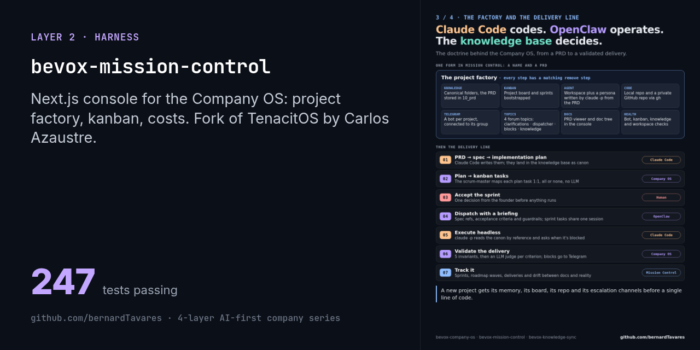
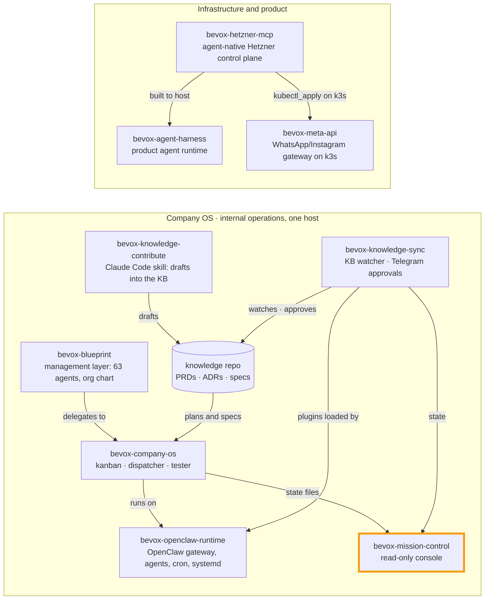

# Bevox Mission Control

[](#) [](./LICENSE)  



> Part of the [4-layer AI-first company series](https://github.com/bernardTavares) ([how the repos fit together](#how-the-repos-fit-together)). License: MIT (fork of TenacitOS by Carlos Azaustre)

A web console for supervising a company run by AI agents. It shows:
- what each agent is doing and what it costs;
- whether the company's knowledge base is in sync;
- what's in the agents' kanban and sprints;
- where each project and its roadmap stand.

It is the read side of the [Bevox Company OS](https://github.com/bernardTavares/bevox-company-os). That OS is a set of supervised agents that turn implementation plans into tasks, run headless Claude Code sessions to execute them, validate the results and escalate to a human on Telegram.

> **Fork notice.** This is a fork of **[TenacitOS](https://github.com/carlosazaustre/tenacitOS)** by Carlos Azaustre, an MIT-licensed Next.js dashboard for [OpenClaw](https://openclaw.ai). The original copyright and license are kept in [LICENSE](./LICENSE). Fork details are in [NOTICE.md](./NOTICE.md). The fork removed some upstream features (the 3D office, the password login) and added about 24k lines across 274 files.

> **Status:** it ran as an internal service for Bevox. It reads local files written by the Company OS, so without that runtime most pages show empty states.

## Design rule: the dashboard doesn't approve anything

Approvals live in **Telegram and the CLI**, never in the UI. The console shows state. It has no approve or reject buttons, and `CLAUDE.md` tells coding agents never to add them. The few writes it does make (creating, editing or deleting projects, connecting a bot) go through the Company OS CLI. A delete needs typed confirmation.

## What I added on top of TenacitOS

| Area | What it does |
|---|---|
| **Edge auth** | Cookie and password auth were replaced with **Cloudflare Access** trust. The middleware accepts only the `Cf-Access-Authenticated-User-Email` header, checked against an allowlist. `/api/health` stays public for tunnel checks. The service listens on loopback only. |
| **Agent-state data layer** (`src/lib/bevox/`) | Read-only readers over the Company OS runtime: a paths registry, knowledge-sync state, a snapshots index, git and systemd readers. It also has a **SQLite indexer** for the append-only `events.jsonl` that tails the file idempotently. It survives growth, rotation and half-written trailing lines, and runs in WAL mode. |
| **Kanban and sprints** | Drag-and-drop kanban for agent tasks (`@dnd-kit`), `blocked_by` dependencies, sprints per project, and a cross-project sprint board. |
| **Projects** | Project list with health dots and a tabbed detail page (overview, roadmap, files, sprints). It includes a PRD viewer, a tree of the canonical knowledge folders, and a project **factory** that creates, edits and deletes projects through the CLI. Each project can connect its own Telegram bot and initialise its topics. |
| **Delivery and roadmap** | Delivery tracker, a strategic roadmap with dependency chips, and a drift dashboard that compares canonical docs with reality. |
| **Cost and finance** | Cost alerts from a usage-tracking DB, plus a finance and runway view. |
| **Knowledge health** | Knowledge-sync state, timers, snapshots, and watcher feedback. |
| **Security fix** | The per-project file reader accepted `..` segments, which could escape into a sibling project. It now rejects `..`, `.` and null-byte segments up front, then checks that the resolved path stays inside the project root. Four regression tests cover it. |

## Running it

```bash
git clone https://github.com/bernardTavares/bevox-mission-control.git
cd bevox-mission-control
npm ci                 # Node 22
npm test               # 247 tests (Vitest)
npx tsc --noEmit
npm run build
cp .env.example .env.local && npm run dev    # http://127.0.0.1:3000
```

The paths in `.env.example` point at a Company OS runtime under `~/.openclaw`. `deploy/` has the systemd user unit and the Cloudflare Tunnel and Access setup it ran with.

Known rough edges:
- **Lint.** `npm run lint` reports 44 errors that predate this release. 27 of them are in files inherited from upstream; most are `no-explicit-any` and a few are newer `react-hooks` rules.
- **Inherited pages.** Some upstream pages (terminal, system monitor) assume a VPS layout. They are untouched.

## How this was built

Every module started as a spec and an implementation plan in the Company OS repo. Claude Code then implemented it under repo-local rules (`CLAUDE.md`, `.claude/`). Two local code graphs, `codegraph` (MCP) and `code-review-graph`, let agents check the blast radius of an edit before making it.

## How the repos fit together

This repo is one piece of Bevox's public code. The repos form two systems: the **Company OS**, which ran Bevox's internal operations on one host on top of OpenClaw, and the **infrastructure** the product was built to run on.



| Repo | Role | Runs with |
|---|---|---|
| [bevox-openclaw-runtime](https://github.com/bernardTavares/bevox-openclaw-runtime) | OpenClaw gateway config, agents (Vox + local Qwen), cron jobs, systemd units | everything in the Company OS runs on it |
| [bevox-company-os](https://github.com/bernardTavares/bevox-company-os) | Supervised agents: plan → kanban → headless Claude Code → tester → Telegram | runtime, mission-control, knowledge-sync |
| [bevox-mission-control](https://github.com/bernardTavares/bevox-mission-control) | Read-only web console over the Company OS state (fork of TenacitOS) | company-os, knowledge-sync |
| [bevox-knowledge-sync](https://github.com/bernardTavares/bevox-knowledge-sync) | Knowledge-repo watcher + OpenClaw plugins for approvals on Telegram | runtime, knowledge-contribute |
| [bevox-knowledge-contribute](https://github.com/bernardTavares/bevox-knowledge-contribute) | Claude Code skill that writes PRDs, ADRs and specs as draft branches | knowledge-sync |
| [bevox-blueprint](https://github.com/bernardTavares/bevox-blueprint) | Management layer: 63 Claude Code agents, org chart, RACI, OKRs | company-os |
| [bevox-hetzner-mcp](https://github.com/bernardTavares/bevox-hetzner-mcp) | MCP server + REST control plane for Hetzner Cloud with an approval gate | built to host the agent harness; manages meta-api's k3s |
| [bevox-meta-api](https://github.com/bernardTavares/bevox-meta-api) | Multi-tenant WhatsApp/Instagram gateway that ran in production on k3s | hetzner-mcp |
| [bevox-agent-harness](https://github.com/bernardTavares/bevox-agent-harness) | The product's agent runtime: per-step reasoning escalation, token-budgeted context, fail-closed permissions, evals, MCP | hetzner-mcp |

## License

MIT, as upstream. See [LICENSE](./LICENSE). TenacitOS is © Mission Control Contributors, and the fork's additions are © 2026 Bernard Tavares.
